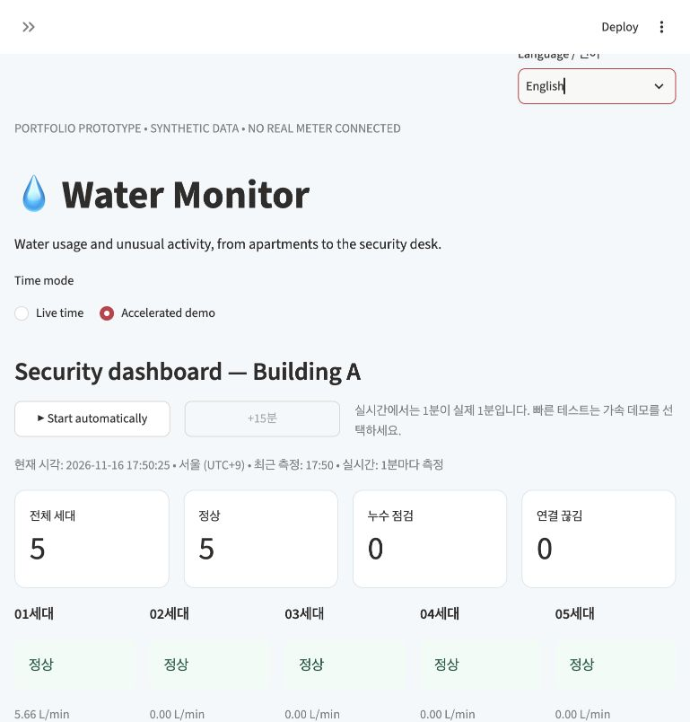

# Water Monitor

A local portfolio prototype that flags unusual apartment water usage for security staff to inspect. It combines an Isolation Forest model, a Streamlit dashboard, 15 virtual apartments, and an incident management workflow.

**All water readings are synthetic. No real meter or valve is connected.** The prototype demonstrates a workflow; it does not establish real-world leak detection performance.



## Features

- Live-time monitoring using Asia/Seoul time (UTC+9), with one simulated reading per real minute.
- An accelerated demo with manual steps and automatic playback.
- Leak, 15-minute shower, normal usage, and sensor disconnection scenarios.
- Apartment status cards, flow charts, optional alert sounds, and incident history.
- Acknowledge and resolve actions, staff notes, and CSV exports.
- A local SQLite archive that retains incidents, outcomes, notes, and activity across resets and app restarts.
- English by default, with Korean and Uzbek available through **Language / 언어 / Til**. Switching languages preserves the current session and staff notes.
- Comparison of the AI-assisted detector against simple 20- and 60-minute rules.

## Quick start

Tested with Python 3.14. From a terminal:

```sh
git clone https://github.com/Mery0011/water-monitor.git
cd water-monitor
git switch develop
python3 -m venv .venv
.venv/bin/python -m pip install -r requirements.txt
.venv/bin/python -m streamlit run app.py --server.port 8503 --server.address 127.0.0.1 --browser.gatherUsageStats false
```

Open [http://127.0.0.1:8503](http://127.0.0.1:8503). Keep the terminal open; press **Ctrl+C** to stop the server. If port 8503 is occupied, use another available port or open the existing instance.

The trained model is included in `artifacts/`, so retraining is optional. The model runs locally with scikit-learn and requires no paid AI API, API key, or GPU. Only load joblib files from trusted sources.

The existing macOS `start.command` launcher expects a virtual environment in the **parent directory** (`../.venv`). For a fresh clone with the environment created inside this repository, use the command above.

## Two-minute demo

Select **Accelerated demo** first. The default **Live time** mode follows the real clock, so a 20-minute condition requires real elapsed time. Changing the time mode resets the demo session.

1. Select **Apartment 03** and click **Start leak**.
2. Click **+15 minutes** twice. This adds a continuous simulated leak of 0.7 L/min. In this scenario, an alert appears after 20 simulated readings.
3. Click **Acknowledge** in the alert card.
4. Open **Complete inspection**, select an outcome, optionally enter a staff note, and click **Resolve**. Resolving an active water incident also stops its simulated leak, resets the current flow to zero, and restores normal status. Earlier readings and incident history remain visible. No physical valve is controlled.
5. Try **Disconnect sensor** in another apartment, then advance time to create a separate connection alert. Use **Restore normal** to resume readings.
6. Try **Shower — 15 minutes**. It simulates 7 L/min for 15 minutes and then ends automatically.
7. Download the incident report from **Incident history and report**.

In accelerated autoplay, two seconds represent five virtual minutes. Every virtual minute is processed by the detector. The demo stops at 23:59; **Reset demo** starts a new session. Live-time monitoring continues across midnight.

A flat line at zero means no water is flowing. A paused demo updates only after autoplay starts or a manual step is taken. Alert sound is optional and may be blocked by browser autoplay settings.

## Model and evaluation

`engine.py` generates illustrative household usage: short activities, showers, washing pulses, occasional long legitimate use, and small continuous leaks. These assumptions are not measured household statistics.

- **Training:** 60 independent synthetic days without leaks; 40,000 sampled rows. Isolation Forest uses 160 trees, `max_samples=512`, and `random_state=42`.
- **Features:** current flow, trailing 15/60-minute averages, trailing 15-minute standard deviation, continuous-flow duration, and sine/cosine time-of-day features. Features do not use future readings.
- **Validation:** 24 separate synthetic days. The anomaly threshold is selected by minute-level F1, with a lower bound at the 95th percentile of normal training scores.
- **Hybrid detector:** anomaly score above the selected threshold **and** at least 20 consecutive active readings. The score is not a leak probability.
- **Test:** 24 additional independent days, including 12 with leaks and 12 without. Training, validation, test, and interactive demo use different seeds.

### Synthetic test results

Precision, recall, and F1 below are measured **per minute** and apply only to the synthetic test set.

| Method | Precision | Recall | F1 | Leak days detected | Normal days with alerts | Median delay |
|---|---:|---:|---:|---:|---:|---:|
| AI + 20-minute condition | 91.1% | 88.1% | 89.6% | 12/12 | 5/12 | 19 min |
| 20-minute rule | 91.1% | 88.2% | 89.7% | 12/12 | 5/12 | 19 min |
| 60-minute rule | 98.5% | 63.3% | 77.0% | 12/12 | 0/12 | 59 min |

**Finding:** the AI did not add value over the simple 20-minute rule on this synthetic dataset. Waiting 60 minutes reduced false alerts but delayed detection. Real sensor data is needed to assess whether a learned model offers a useful advantage.

Detecting a leak day means at least one minute during the leak was flagged; it does not mean every leak minute was detected. Delay is calculated only for detected incidents. Twenty consecutive readings have a 19-minute first-to-last time difference. Alerts on 5 of 12 normal days show that false alerts need attention before a real pilot.

The dashboard keeps an incident active until flow stops to avoid duplicate incidents caused by score fluctuations. The metrics table evaluates raw minute-level detector predictions rather than this incident retention policy. Both should be evaluated in a real deployment.

## Incident workflow and limitations

Incidents move through **New → Acknowledged → Resolved**. Signal activity is tracked separately from inspection status. Resolving an active water incident simulates repair; a later leak can create a new incident ID. Connection loss is a separate incident type, and missing readings break continuous-flow tracking.

Incidents, inspection outcomes, staff notes, and activity entries are saved to `data/water-monitor.sqlite3` using Python's built-in SQLite module. No extra service or database installation is needed. Writes are transactional, repeated saves do not duplicate incidents, and each session has a unique identifier so that incident numbers from different runs do not collide.

Use **Saved history — all sessions** to view and export records after a reset or restart. **Pending inspections from previous sessions** lets staff acknowledge or resolve archived incidents. An archived signal is historical, not a current sensor reading; resolving it does not change the new simulation. Simulation frames and playback position are not restored after a restart.

Resetting or changing time mode starts a new simulation without deleting saved history. The database and its journal files are excluded from Git. Keep the project folder writable, retain its `data/` directory when moving the project, and stop the app before copying the database for backup. No delete-history button is provided.

The archive is a local, single-operator prototype, not a production audit service. There is no staff authentication, role system, SMS integration, automatic water shutoff, or physical sensor connection. Simultaneous operators and large historical datasets have not been validated.

Long legitimate use can trigger alerts, while small or intermittent leaks may be missed. Security staff must inspect flagged situations. This prototype is not ready for unattended use in a real building.

## Retraining and checks

From the repository root, after installing dependencies:

```sh
.venv/bin/python train.py
.venv/bin/python checks.py
```

Checks cover causal features, missing readings, short showers, incident creation and resolution, duplicate suppression, subsequent incidents, day boundaries, live time, Streamlit interactions, language switching without losing incident state or notes, SQLite round trips, unique session IDs, repeated saves, save failures, and completing saved inspections after a fresh browser session.

## Project files

| File | Purpose |
|---|---|
| `app.py` | Streamlit security dashboard |
| `engine.py` | Synthetic telemetry, features, detection, and incident state |
| `storage.py` | SQLite incident persistence and archived inspection updates |
| `data/water-monitor.sqlite3` | Local incident database, created automatically and excluded from Git |
| `train.py` | Training, validation, and test evaluation |
| `i18n.py` | English, Korean, and Uzbek interface translations |
| `checks.py` | Regression checks |
| `artifacts/water_model.joblib` | Trained model and threshold |
| `artifacts/metrics.json` | Evaluation results and dataset configuration |
| `artifacts/example_day.csv` | Example synthetic test day |
| `PORTFOLIO.md` | Portfolio project description and presentation notes in English |

## Branch workflow

- **master:** main version.
- **develop:** ongoing development. Review changes before merging them into `master`.

## Next steps

Agree on a real meter's data format, pilot one sensor, collect labeled real-world incidents, and compare detectors again. A production system would also need managed backups and schema migrations, staff access controls, network recovery and buffering, operating procedures, and appropriate permissions.
